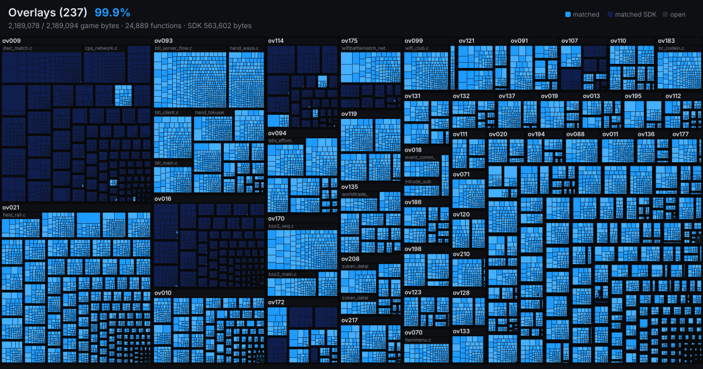
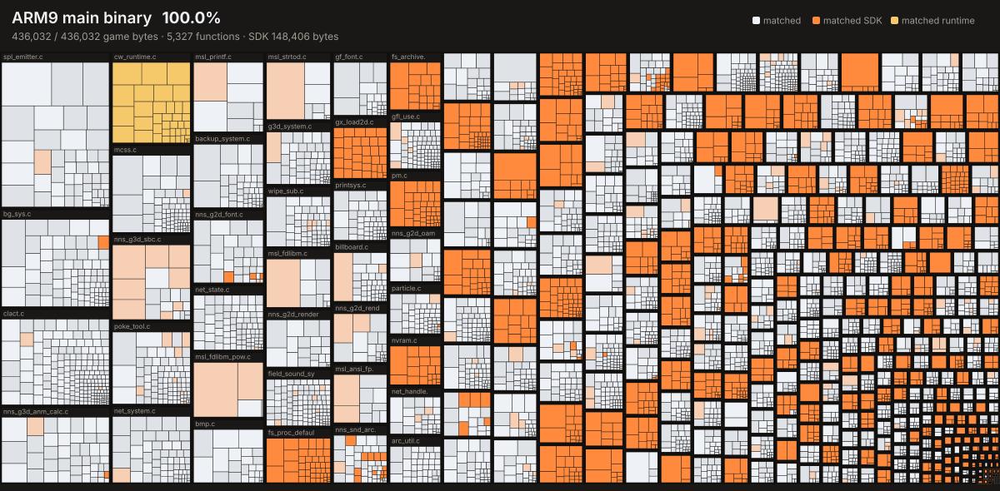
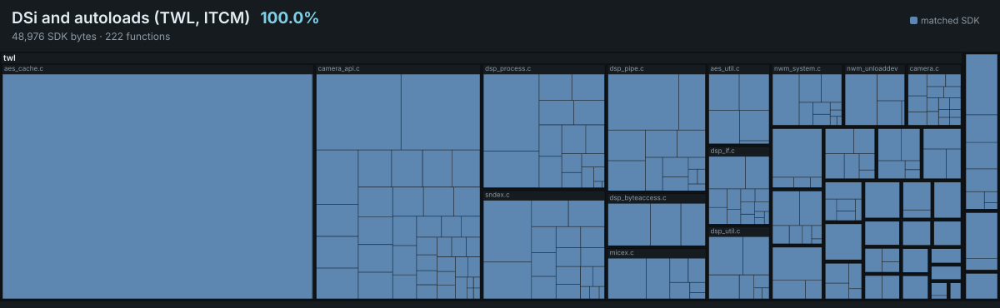

# aletheia

A decompilation project for Pokémon Black (and eventually White).

This project shares no code with any existing decompilation effort. All tooling
(ROM extraction/rebuilding, disassembly, build system) is written independently
for this repository.

## Overlays

237 overlays, 1,876,372 game code bytes (+518,900 SDK bytes), 27,646 labelled functions (798 of them Thumb-entry linker veneers, counted as neither),
  1,834,206 matched (97.7528% of game), plus 3,234 SDK functions (518,900 bytes) matched.
Bytes are instruction bytes on both sides, the measure used for ARM9: literal pools
and data runs are not counted as matched or as work.



## ARM9 main binary

412,048 game bytes, 5,239 functions, byte-matching. SDK: 1,205 of 1,205 functions matched (132,824 of 132,824 bytes).



## DSi `twl` region and ARM9 autoloads

twl: 204 functions, 39,012 SDK bytes (all matched) and 440 game bytes. ITCM
100%. The DSi-mode `twl` block and the ARM9
autoload blocks (ITCM, the two MAIN_TWL stubs and VRAM_LCDC) are not part of
the ARM9 static image or the overlays, so they have a map of their own.




## Goal

Fully decompile Pokémon Black (and eventually White) to readable, buildable C source that produces a
byte-matching ROM.

## Status

### Decompilation (aletheia)

- [x] **Milestone 1**: ROM extraction and rebuild
  - [x] Extract ROM filesystem with `tools/ndsrom.py`
  - [x] Rebuild a byte-matching, launchable `.nds`
  - [x] Verify the rebuilt ROM boots in melonDS (other emulators and hardware untested)
- [x] **Milestone 2**: Delink, disassemble, and prove reassembly
  - [x] BLZ-decompress and delink ARM9 binary + all 237 overlays
  - [x] Disassemble with `tools/disasm.py` (ARM/Thumb, code/data split)
  - [x] Reassemble byte-identically (`tools/build.py`: 242 of 242 regions PASS; 243 of 243 with the DSi-mode region `twl`, decrypted with a user-supplied key)
  - [x] Split ARM9 into ordered translation units
  - [x] Decrypt overlay 230's self-encrypting code for disassembly (`tools/ovcrypt.py` replays the game's own decryptor; no key needed)
- [~] **Milestone 3**: Incremental decompilation to matching C
  - [x] Build system compiles C and links against remaining assembly
  - [x] Pokémon data field map and the message text cipher (`src/matched/`)
  - [x] Stat calculator, pokeparty.c, level-up and evolution logic
  - [x] About 1000 original source filenames recovered from `__FILE__` anchors (`layout/file_anchors.txt`)
  - [x] ARM9 main binary, game-written functions: all 4422 ship as verified C (400306 of 400306 bytes; wave 21, 2026-09-24, confirmed by a full ROM rebuild against the cartridge SHA-1). This is the narrow figure `tools/worklist.py --summary` reports. It does **not** cover:
    - the ~1100 NitroSDK / NitroSystem library functions and the compiler runtime (MSL, soft-float) linked into ARM9, which are still reassembled listings;
    - the ITCM block and the DSi-mode `twl` region;
    - any of the 237 overlays (the bulk of the game: field, battle, menus).
  - Verified means recompiled and byte-identical to the original at every integration; unmatched functions are carried as reassembled listings so the ROM always rebuilds byte for byte.
  - [ ] Boot path: system init, overlay loader, `tcbl.c`, `bg_sys.c`,
        `palanm.c`, `clact.c`, `gf_font.c`, title and field managers
  - [ ] Field and battle loop call trees
  - [ ] Overlays: 23,365 of 23,614 game functions are matched (1,834,206 of 1,876,372 game instruction bytes, 97.75%), plus 3,234 of 3,234 SDK functions (518,900 of 518,900 SDK instruction bytes) matched; the remaining 237 overlay regions are still carried as reassembled listings
  - [ ] 100% matching across the whole ROM

- [ ] **Milestone 4**: Native PC port ([eidos](https://github.com/Project-Holon/eidos))
- [ ] **Milestone 5**: Pokémon White support

Companion project: [eidos](https://github.com/Project-Holon/eidos) is the native runtime engine and PC port companion to aletheia.

See [docs/ROADMAP.md](docs/ROADMAP.md) for the planned approach, and
[docs/NOTES.md](docs/NOTES.md) for technical findings recorded along the way.

## Requirements

- Python 3.11+
- Your own legally dumped ROM of Pokémon Black (USA, Europe) (NDSi Enhanced)
  - SHA1: `26ad0b9967aa279c4a266ee69f52b9b2332399a5`
  - Size: 268435456 bytes
  - Place it in the repo root (any `*.nds` filename works; commands below
    take the path as an argument)
- Optional, only for the DSi-mode region `twl`: the 16-byte DSi AES
  key-scrambler constant in a file you keep outside the repo, passed as
  `--dsi-key` or `ALETHEIA_DSI_KEY` (a DSi ARM9 BIOS dump does not contain
  it); it is never committed, and without it the build is the usual 242
  regions.

## Usage

```
python tools/ndsrom.py extract "<your-rom>.nds" -o extract
python tools/ndsrom.py build extract -o build/pokeblack.nds
python tools/ndsrom.py verify extract build/pokeblack.nds
```

The rebuilt ROM runs in melonDS, DeSmuME, or on real hardware via flashcart.

To delink, disassemble and prove the disassembly reassembles byte-identically:

```
pip install capstone
python tools/delink.py
python tools/disasm.py arm9 --split
python tools/disasm.py overlay --all
python tools/build.py --arm9-image          # all 242 regions
python tools/build.py --split --only arm9   # ARM9 from its translation units
```

### Setup per platform

Every tool is plain Python 3 (stdlib, plus `capstone` for the disassembler) and
finds what it needs through `tools/env.py`; `python tools/env.py` prints what
it resolved and `python tools/selfcheck.py` compiles one matched function and
runs one split build.

- **Windows**: unpack the xPack `arm-none-eabi-gcc` win32-x64 zip into
  `tools/gcc-arm/`. The CodeWarrior compilers in `tools/mwccarm/` run
  directly. For the eidos port, unpack the xPack `mingw-w64-gcc`, CMake and
  Ninja Windows zips into `tools/gcc-host/`, `tools/cmake/` and `tools/ninja/`.
- **macOS**: unpack the xPack `arm-none-eabi-gcc` darwin zip (x64 or arm64)
  into `tools/gcc-arm/`, and install wine (`brew install --cask wine-stable`)
  so `mwccarm.exe` can run. For eidos, unpack the CMake and Ninja macOS
  archives into `tools/cmake/` and `tools/ninja/`, or rely on Xcode's clang
  and any CMake/Ninja on `PATH`.
- **Linux**: unpack the xPack `arm-none-eabi-gcc` linux-x64 (or arm64) archive
  into `tools/gcc-arm/`, and install wine from the distribution
  (`apt install wine` or equivalent). For eidos, unpack the CMake and Ninja
  Linux archives into `tools/cmake/` and `tools/ninja/`, or use the system
  gcc, cmake and ninja on `PATH`.

Nothing else is platform-specific. `--toolchain` or `BW_ARM_TOOLCHAIN` can
point at any other `bin/` directory holding `arm-none-eabi-as`, a binutils on
`PATH` is used as a last resort, and `ALETHEIA_SCRATCH` moves the scratch
directory (default: the system temp directory plus `aletheia`). See
[docs/NOTES.md](docs/NOTES.md) for details.

## Acknowledgments

Development of this project is assisted by Anthropic's Claude (via Claude
Code); tooling and documentation are produced with its help under human
direction and review.

## License and legal

The tooling, layout files, documentation and build scripts are released under
the MIT License (`LICENSE`). The reverse-engineered game source under `src/`
is distributed without a license grant and remains the property of Nintendo,
Creatures Inc. and GAME FREAK inc.; see `LEGAL.md`. This repository contains
no game data of any kind: you must dump your own cartridge to use any of it.

## Repository layout notes

`extract/` and `build/` are gitignored on purpose (they are generated from
your own ROM dump) and must never be committed.

Sources are sorted under `src/matched/` and `src/pending/` by region and kind:
`arm9`, `arm9_sdk`, `itcm_sdk`, `ov`, `ov_sdk`, `twl`, `twl_sdk`.
