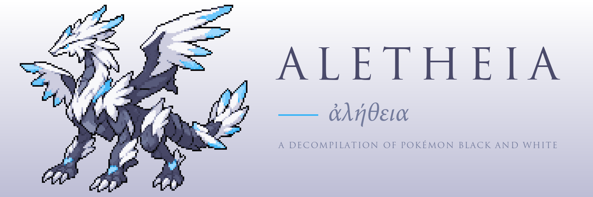
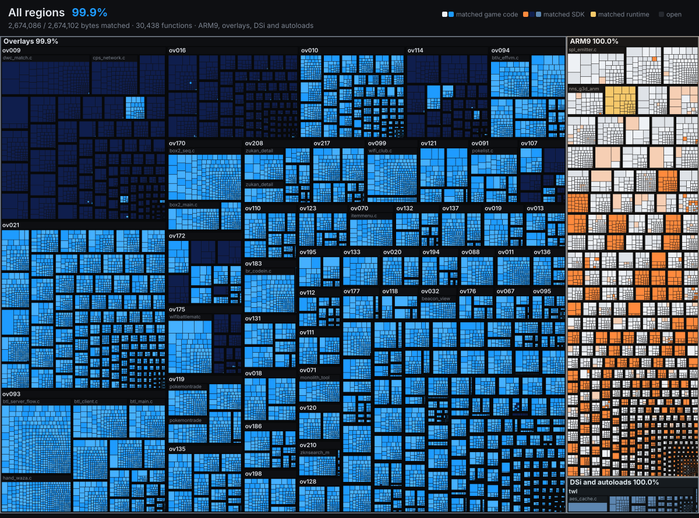

<h1></h1>

A byte-matching decompilation of Pokémon Black (USA/Europe).

All tooling (ROM extraction, rebuilding, disassembly, and build system) is written independently for this repository.

## Status

The project is **100% matched** and links byte-identically to the original ROM using CodeWarrior (`mwldarm`).

| Region | Functions | Instruction Bytes | Match |
|---|---|---|---|
| ARM9 main | 5,418 game + 1,304 SDK | 450,678 game + 144,086 SDK | 100.0% |
| ITCM (autoload) | 11 SDK | 1,826 SDK | 100.0% |
| Overlays (237) | 24,718 game + 3,407 SDK | 2,188,092 game + 564,604 SDK | 100.0% |
| TWL (DSi) | 8 game + 331 SDK | 582 game + 46,600 SDK | 100.0% |
| **Total** | **35,197** | **3,396,468** | **100.0%** |

Decompiled C source code is located in `src/game/` across 1,374 files.

### Coverage Maps



<!-- 


 -->

## Milestones

- [x] **Milestone 1**: ROM extraction and rebuild (`tools/ndsrom.py`)
- [x] **Milestone 2**: Delinking, disassembly, and byte-identical reassembly
- [x] **Milestone 3**: Decompilation to matching C (`src/game/`)
- [x] **Milestone 4**: Pokémon White support (`tools/romlink.py --version white`)
- [ ] **Milestone 5**: Native PC port ([eidos](https://github.com/Project-Holon/eidos))
  - [x] 64-bit ready source (real pointer types)
  - [x] Recovered structs for code that still reads fields by offset
  - [x] Repository cleanup (tool data out of the source, leftover casts and includes)
  - [ ] Fixes for issues the port finds

## Requirements

- Python 3.11+
- Legally dumped ROM of Pokémon Black (USA, Europe) (NDSi Enhanced):
  - SHA-1: `26ad0b9967aa279c4a266ee69f52b9b2332399a5`
  - Size: 268,435,456 bytes
- Optional (for Pokémon White): legally dumped ROM of Pokémon White (USA, Europe) (NDSi Enhanced):
  - SHA-1: `bc696a0dfb448c7b3a8a206f0f8214411a039208`
  - Size: 268,435,456 bytes
- The Metrowerks CodeWarrior for DS compilers and linker (`mwccarm.exe`, `mwldarm.exe`), not included: place them under `tools/mwccarm/mwccarm/<version>/`. The builds use `dsi/1.1p1` for almost all code (33,068 functions), plus `2.0/sp2`, `2.0/sp1p2`, `2.0/sp2p2`, `1.2/sp2` and `1.2` for overlay 230 and some SDK and library objects (530 functions); `layout/matched/` lists the version per function.
- Optional (for DSi-mode `twl` region): DSi AES key constant passed via `--dsi-key` or `ALETHEIA_DSI_KEY`.

## Platform Setup

All tools are written in Python 3. Run `python tools/env.py` to view detected toolchains, or `python tools/selfcheck.py` to verify the environment.

- **Windows**: Unpack xPack `arm-none-eabi-gcc` into `tools/gcc-arm/`. The CodeWarrior binaries you supply in `tools/mwccarm/` run natively.
- **Linux**: Unpack xPack `arm-none-eabi-gcc` into `tools/gcc-arm/`. Install Wine (`apt install wine` or equivalent) to run CodeWarrior binaries.
- **macOS**: Unpack xPack `arm-none-eabi-gcc` into `tools/gcc-arm/`. Install Wine (`brew install --cask wine-stable`).

## Usage

### 1. Extract and Verify ROM

```bash
python tools/ndsrom.py extract "<your-rom>.nds" -o extract
python tools/ndsrom.py build extract -o build/pokeblack.nds
python tools/ndsrom.py verify extract build/pokeblack.nds
```

### 2. Build from C Source

Build the complete ROM from `src/game/`:

```bash
python tools/romlink.py
```

Link individual regions or overlays:

```bash
python tools/gamelink.py arm9_main
python tools/gamelink.py 12              # overlay 12
```

### 3. Reassembly and Validation

To delink, disassemble, and verify assembly listings:

```bash
pip install capstone
python tools/delink.py
python tools/disasm.py arm9 --split
python tools/disasm.py overlay --all
python tools/build.py --arm9-image
```

## Repository Structure

- `src/game/`: Decompiled C source files.
- `tools/`: Build scripts, ROM extractors, disassemblers, and link drivers.
- `layout/`: Memory maps, symbols, and region definitions.
- `docs/`: Technical notes, documentation, and progress tracking.
- `extract/`: Extracted ROM contents (generated, gitignored).
- `build/`: Build artifacts and linked binaries (generated, gitignored).

## Related Projects

- [eidos](https://github.com/Project-Holon/eidos): Native PC port and engine companion.

## Acknowledgments

Development of this project is assisted by Anthropic's Claude (via Claude Code); tooling and documentation are produced with its help under human direction and review.

## License and Legal

Tooling, layout definitions, and documentation are licensed under the MIT License (`LICENSE`).

The reverse-engineered game source code in `src/` is distributed without license grant and remains the intellectual property of Nintendo, Creatures Inc., and GAME FREAK inc. (see `LEGAL.md`). This repository contains no copyrighted game assets or proprietary ROM data.
